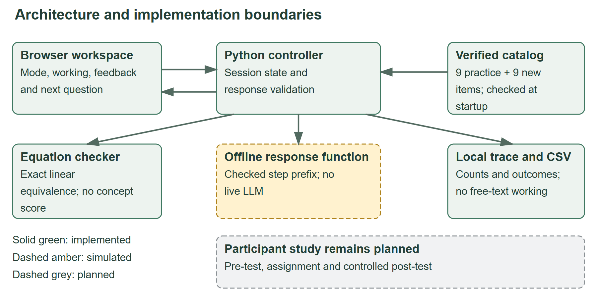
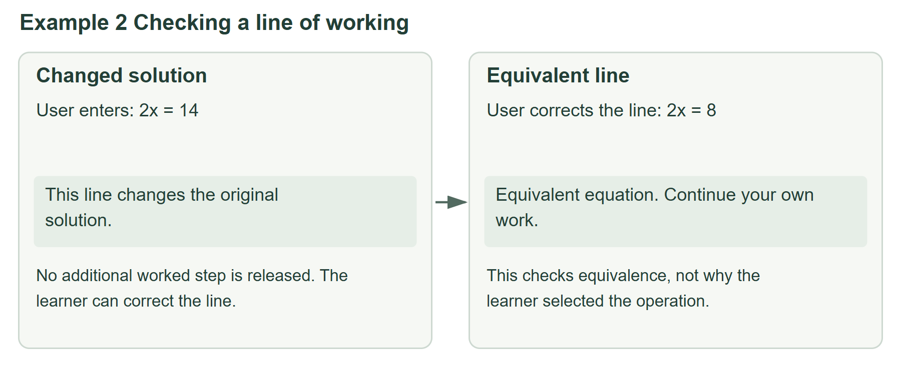

# Controlled Help in an Algebra Tutoring Prototype

IIS A2 Project Report

Word count: 1164 total (125 abstract, 1039 main text including headings and disclosures).

## Abstract

This browser-based tutor asks a practical question about algebra revision. After working through one equation, can a student solve a similar one without help? In one mode, students can ask what to do next and work out the result themselves. In the other, they can read the whole worked example, including the answer, from the start. Each of the thirteen built-in practice equations has a partner that tests the same skill with different numbers. The tutor checks students’ working and records whether their first answer to the partner question was correct, separately from any retries. Automated tests showed that the system could track this distinction across sessions. A comparison with students is still needed to find out which approach helps them solve a new equation.

## Problem and scope

A1 asked whether trying a problem before seeing help prepares students to solve a related problem on their own. Koedinger and Aleven (2007) call the decision about when to offer help the assistance dilemma. Here the learner decides. A university student revising algebra might solve a two-step equation mentally, yet still want help when a minus sign applies to a whole bracket. Four built-in pairs cover common denominators, nested brackets or decimal coefficients.

The prototype grew from Lab4. In an early trial, its image importer picked up only the last number in a screenshot. A student would have had to repair the question before doing any algebra. The current version uses stored equations and a local question generator. Either mode can use a saved pair. This also lets a developer trace a wrong hint back to a particular line of working. The provenance record identifies the parts inherited from Lab4.

## Design choices and supporting evidence

Both modes draw on one worked solution. In step-hint mode a student can ask for the next operation before entering any working. The result of that operation stays hidden until the student solves the equation. In full-example mode the same derivation and its answer are visible immediately. Atkinson, Renkl and Merrill (2003) studied how learners move from examples to independent work by fading worked steps and prompting self-explanation. Here, students choose when to request help. Sale and Muldner (2019) found similar overall learning outcomes for high-level and answer-giving hints in their algebra tutor.

When clearing denominators, a student may need to look back at the multiplier while expanding a bracket. Earlier hints therefore stay visible. The Week 2 lecture on working memory explains why leaving information in view can ease the demand on recall (University of Birmingham, 2026). Each extra hint costs a click. A learner who wants to read straight through can select the full example at the start. Switching modes starts a new record.

## Design choices continued

The checker tests whether two equations have the same unique solution. On A10, for instance, a student can write “Multiply both sides by 12”, type a colon, then enter the new equation. The checker reads the mathematics after the colon. It would accept an equivalent equation even if the words before it gave the wrong reason. Kim et al. (2009) assessed procedural and conceptual knowledge separately when comparing tutoring with worked examples. To assess reasoning here, a study would need a question asking students to justify a step and criteria for marking their answers.

Amershi et al. (2019) recommend explaining what a system can do and making errors easy to correct. The tutor distinguishes an unfinished equation from one that changes the solution. In the first case it asks the student to finish the line. In the second, the student can check a sign or revisit the operation on each side. Checking a line leaves the next hint closed. Students can also save an explanation without a mark. For a comparison of the help modes, the equation checker can be set the same way for both groups.

## Architecture and interaction

Figure 1 shows what happens when a student requests help. The local controller looks up the saved solution, asks a simulated tutor for the steps the current mode allows, then checks the reply before showing it. If a reply is missing or malformed, the student can still read earlier hints. This follows the distinction in Week 3 between instructing a model and checking its output in code (University of Birmingham, 2026). The prototype runs locally. Students can work in English or with English and Chinese labels side by side.

Figures 2–4 use shorter equations. A10 shows why checking a single line matters on a harder problem. Clearing the denominators gives 3(3x − 2) − 2(x + 1) = 4(x − 1). It is easy to lose the minus sign when expanding the second bracket. A student can check that line before going further. Once the student reaches 4/3, the tutor offers T10, which uses different coefficients and has a different answer.

Figure 1. Implemented controls, the simulated tutor boundary and the planned participant study.

## Illustrated interaction

Figure 2. The first hint names an operation. The full example shows the worked equations.

Figure 3. Equation feedback flags a changed solution and recognises a corrected equivalent line.

Figure 4. Live results shows whether P01’s first and latest independent answers were correct.

## Development evidence and limits

An observer can open Live results in a second tab on the same computer. When a student with a tester code solves the equation, the board lists the equation, mode, attempts and steps viewed. The board refreshes every two seconds. For the paired question it shows whether the first and latest valid answers were correct, even after a successful retry. Students may also rate how helpful the steps were. An unfinished practice session never reaches the board, so these records alone cannot show how many students gave up.

At startup, exact arithmetic checks every built-in pair. Each intermediate equation must preserve the original solution, and substituting the final value must balance both sides. On A13, for instance, clearing the denominators still leaves several brackets to expand. Checking only the answer at the end would miss a sign error in an earlier line. The partner answer is checked separately.

All 45 unit tests passed. In one automated browser test, P01 and 03 worked in separate sessions while a third tab displayed the results. P01 entered 1 on T01, then tried again with 3. The board kept the incorrect first attempt beside the correct latest result. Filtering for 03 brought up the other session. This test checked that retries and tester codes stayed separate.

Bastani et al. (2025) tested high school students again after withdrawing AI assistance. For this prototype, the clearest comparison would be the proportion of students in each mode who solve a new, matched equation on their first unaided attempt. Later attempts already benefit from feedback. A study would need to measure prior knowledge, assign the modes before practice and pilot the harder pairs with students. Any difference would reflect the two modes as a whole: they change both when help appears and how much of the solution students see.

## AI assistance

OpenAI Codex helped implement the tutor, draft exercises, run software checks and edit this report. The examples above come from automated browser sessions. No students took part in those tests.

## Repository and submitted version

Submitted version · [Public GitHub repository](https://github.com/34248/iis-a2-algebra-tutor) · [README](https://github.com/34248/iis-a2-algebra-tutor/blob/a2-submission-v1/README.md) · [a2-submission-v1](https://github.com/34248/iis-a2-algebra-tutor/tree/a2-submission-v1). The README gives run instructions and links to the development record.

## References

Amershi, S. et al. (2019). Guidelines for human–AI interaction. Proceedings of the 2019 CHI Conference on Human Factors in Computing Systems, pp. 1–13. [doi:10.1145/3290605.3300233](https://doi.org/10.1145/3290605.3300233) · [Full text (PDF)](https://www.microsoft.com/en-us/research/wp-content/uploads/2019/01/Guidelines-for-Human-AI-Interaction-camera-ready.pdf)

Atkinson, R. K., Renkl, A. and Merrill, M. M. (2003). Transitioning from studying examples to solving problems: Effects of self-explanation prompts and fading worked-out steps. Journal of Educational Psychology, 95(4), pp. 774–783. [doi:10.1037/0022-0663.95.4.774](https://doi.org/10.1037/0022-0663.95.4.774) · [Full text (PDF)](https://mrbartonmaths.com/resourcesnew/8.%20Research/Making%20the%20most%20of%20examples/Fading%20out%20and%20Prompts.pdf)

Bastani, H. et al. (2025). Generative AI without guardrails can harm learning: Evidence from high school mathematics. Proceedings of the National Academy of Sciences, 122(26), e2422633122. [doi:10.1073/pnas.2422633122](https://doi.org/10.1073/pnas.2422633122) · [Author preprint (PDF)](https://hamsabastani.github.io/education_llm.pdf)

Kim, R. S., Weitz, R., Heffernan, N. T. and Krach, N. (2009). Tutored problem solving vs. “Pure” worked examples. Proceedings of the 31st Annual Meeting of the Cognitive Science Society, pp. 3121–3126. [Proceedings record](https://escholarship.org/uc/item/35w4h4zt) · [Full text (PDF)](https://escholarship.org/content/qt35w4h4zt/qt35w4h4zt.pdf)

Koedinger, K. R. and Aleven, V. (2007). Exploring the assistance dilemma in experiments with Cognitive Tutors. Educational Psychology Review, 19(3), pp. 239–264. [doi:10.1007/s10648-007-9049-0](https://doi.org/10.1007/s10648-007-9049-0) · [Full text (PDF)](https://pact.cs.cmu.edu/koedinger/pubs/paper%20%2314.pdf)

Sale, K. and Muldner, K. (2019). Learning with an algebra computer tutor: What type of hint is best? Proceedings of the 41st Annual Meeting of the Cognitive Science Society, pp. 2708–2714. [Proceedings record](https://escholarship.org/uc/item/8gv8k0t5) · [Full text (PDF)](https://escholarship.org/content/qt8gv8k0t5/qt8gv8k0t5.pdf)

University of Birmingham (2026). Memory, Mental Models and Cognitive Load (Week 2, Lecture 05) and Prompting as Interaction: Specifying and Checking a Model Call (Week 3, Lecture 09). Intelligent Interactive Systems [lecture slides]. [Canvas course modules](https://canvas.bham.ac.uk/courses/90253/modules)
