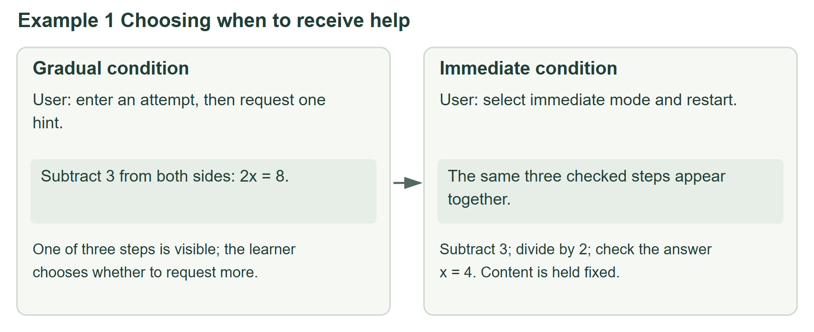
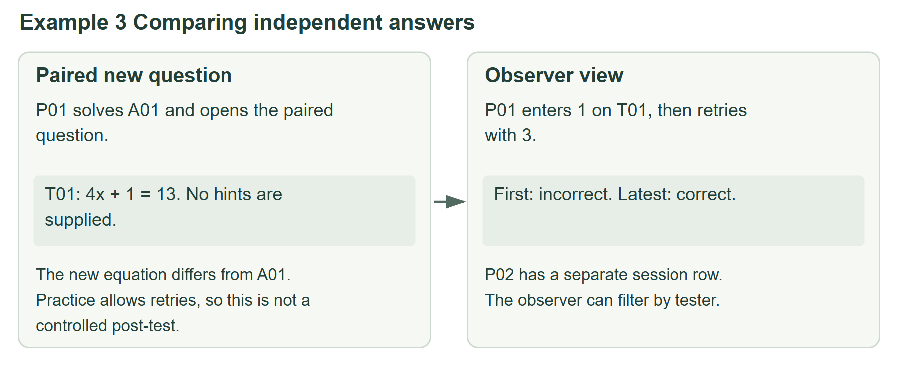

# Controlled Help in an Algebra Tutoring Prototype

IIS A2 Project Report

Word count: 1218 total (132 abstract, 1086 main text including headings and disclosures).

## Abstract

How much help should a tutor give a student who is halfway through an equation? This local browser tutor offers two ways to work through the same algebra problem. Students can request one step at a time, with or without first submitting an attempt, or open the complete worked example at the start. Each of the thirteen built-in equations has a partner for independent practice. Four harder pairs cover common denominators, nested brackets and decimal coefficients. The program checks whether a submitted equation has the same solution as the original and lets the student revisit earlier hints. A local response function delivers the worked steps. An observer can compare the first and latest independent answers from labelled sessions. Whether either mode helps students solve a new equation independently remains an open question.

## Problem and scope

A1 asked whether students who attempt a problem before seeing help can later solve a related problem independently. Koedinger and Aleven (2007) describe the difficulty of deciding when to give information and when to leave the next move to the learner. The intended users here are university students revising algebra. For a student who can already solve a two-step equation mentally, opening a hint says little about the value of the help. The harder items give that student a reason to pause, particularly when a minus sign applies to an entire bracket.

The prototype grew out of the Lab4 tutor. In a later trial, image import read only the final number in a screenshot of a simple equation. That left the learner correcting the transcription before they could try any algebra. Each saved question stays the same across modes, including locally generated pairs. It also makes an error easier to locate: the author can check the question, the learner’s line and the next hint against one another. The original lab and its reuse are documented in the project’s provenance record.

## Design choices and supporting evidence

Both modes use the same authored solution. In gradual mode, students decide when to reveal each step. They can ask for the first hint with the working box empty. Immediate mode displays the whole sequence at once. Atkinson, Renkl and Merrill (2003) studied the transition from examples to independent problem solving using fading and self-explanation prompts. The present tutor changes when steps appear. Sale and Muldner (2019) found no significant overall difference between the two kinds of algebra hint they tested. These studies leave room for either outcome in a comparison of the present modes.

A learner clearing denominators may want to check the multiplier while expanding the next bracket. Earlier steps therefore stay on screen. This applies the Week 2 discussion of working memory and information held in the interface (University of Birmingham, 2026). The cost of gradual release is an extra action for each hint. A student who wants to inspect the whole derivation can choose the worked example before starting. Changing the help mode starts a fresh record so that the two kinds of practice can be inspected separately.

## Design choices continued

The checker tests a narrow mathematical claim. For example, on A10 the learner can enter “Multiply both sides by 12” followed by a colon and the new equation. The program reads the equation after the colon and compares its unique rational solution with the original. An incorrect verbal explanation could still accompany an equivalent equation. Kim et al. (2009) distinguish procedural and conceptual outcomes in their comparison of tutoring and worked examples. Assessing a student’s justification would require a separate task and a marking rubric.

Amershi et al. (2019) recommend making system capabilities clear and supporting correction. An incomplete equation produces a prompt to edit it. A well-formed step that changes the solution produces different feedback: the student can revisit the signs or check that the same operation was applied to both sides. Neither action opens a hint. Students can also record a short explanation and continue. The comparison setting allows equation feedback to be switched off for both groups if the study concerns only the presentation of help.

## Architecture and interaction

Figure 1 follows a request from the browser to the local controller. The controller checks the selected problem, looks up its authored steps and asks the simulated response function for the permitted portion. It checks the returned sequence before displaying it. A missing or malformed response leaves earlier hints available. This implements the Week 3 distinction between giving a model instructions and enforcing the allowed output in the application (University of Birmingham, 2026). The browser offers English or bilingual English–Chinese labels for the same exercises.

Figures 2–4 show three interactions using the shorter equations. The same sequence also works on A10. Multiplying its three fractions by twelve gives 3(3x − 2) − 2(x + 1) = 4(x − 1). The negative multiplier on the second bracket is easy to miss. The student can check that line before revealing the expansion. After the final answer, 4/3, the tutor offers T10. Its coefficients and solution differ, so copying the practice answer will fail.

Figure 1. Implemented controls, the simulated tutor boundary and the planned participant study.

## Illustrated interaction

Figure 2. One requested hint and the immediate solution use the same checked content.

Figure 3. Equation feedback flags a changed solution and recognises a corrected equivalent line.

Figure 4. The observer sees P01’s first independent answer and the result after a retry.

## Development evidence and limits

An observer opens Live results in a second tab on the same computer. Each labelled session has a row showing the tester code, question, help mode, attempts and steps shown. For the assigned independent question, the first valid answer stays visible alongside the latest result. A correct retry cannot overwrite an incorrect first answer. The view refreshes every two seconds. Sessions started without a tester code stay off the board. After the paired question, students can also rate how helpful they found the steps.

The catalogue is checked at startup. Each authored intermediate equation must preserve the original solution, and the final substitution must balance. This matters on A13, where multiplying through by twelve still leaves brackets to expand. A plausible final fraction would be poor reassurance if the hint immediately before it contained a sign error. The checker verifies both the practice answer and the independently authored partner’s answer.

All 45 unit tests passed. In a browser test, P01 and P02 used separate sessions while an observer watched a third page. On T01, P01 submitted 1 and then 3. The observer saw an incorrect first answer and a correct latest answer without refreshing the page. Filtering for P02 showed its own record. These codes identify automated test sessions. The tests establish that the tutor keeps the records separate.

Bastani et al. (2025) measured performance after assistance was withdrawn. Their distinction matters here because students can retry the independent exercise and receive immediate feedback. A study would still need consistent conditions for the first unaided response, a measure of prior knowledge and a way to assign the help mode before practice. The challenge pairs also need piloting with the intended learners. Their extra algebraic steps are verified. Their difficulty for that population, and any effect on later learning, remain to be measured.

## AI assistance

OpenAI Codex assisted with implementation, exercise drafting, software checks and report editing. The authored steps were checked by exact arithmetic and the new practice flows were exercised in a browser. The examples in the development record come from these runs.

## Repository and submitted version

Local application revision ce3249b on the algebra-live-results branch. The README gives run instructions and links to the development record. Public repository and README URLs are outstanding.

## References

Amershi, S. et al. (2019). Guidelines for human–AI interaction. Proceedings of the 2019 CHI Conference on Human Factors in Computing Systems, pp. 1–13. https://doi.org/10.1145/3290605.3300233

Atkinson, R. K., Renkl, A. and Merrill, M. M. (2003). Transitioning from studying examples to solving problems: Effects of self-explanation prompts and fading worked-out steps. Journal of Educational Psychology, 95(4), pp. 774–783. https://doi.org/10.1037/0022-0663.95.4.774

Bastani, H. et al. (2025). Generative AI without guardrails can harm learning: Evidence from high school mathematics. Proceedings of the National Academy of Sciences, 122(26), e2422633122. https://doi.org/10.1073/pnas.2422633122

Kim, R. S., Weitz, R., Heffernan, N. T. and Krach, N. (2009). Tutored problem solving vs. “Pure” worked examples. Proceedings of the 31st Annual Meeting of the Cognitive Science Society, pp. 3121–3126. https://escholarship.org/uc/item/35w4h4zt

Koedinger, K. R. and Aleven, V. (2007). Exploring the assistance dilemma in experiments with Cognitive Tutors. Educational Psychology Review, 19(3), pp. 239–264. https://doi.org/10.1007/s10648-007-9049-0

Sale, K. and Muldner, K. (2019). Learning with an algebra computer tutor: What type of hint is best? Proceedings of the 41st Annual Meeting of the Cognitive Science Society, pp. 2708–2714. https://escholarship.org/uc/item/8gv8k0t5

University of Birmingham (2026). Intelligent Interactive Systems lecture materials: Week 2 Lecture 05 and Week 3 Lecture 09. https://canvas.bham.ac.uk/courses/90253/modules
